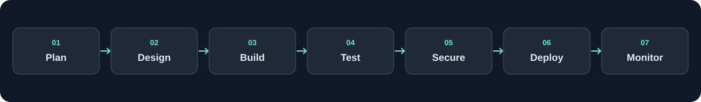

<div align="center">


**مجموعه ۳۰ اسکیل تخصصی برای توسعه نرم‌افزار و ساخت استارتاپ**

[](https://www.npmjs.com/package/hrzjanati-skills)
[](https://www.npmjs.com/package/hrzjanati-skills)
[](https://github.com/hrzjanati/skills)


[🚀 نصب](#install) · [🧭 مسیر ساخت](#workflow) · [📚 اسکیل‌ها](#skills) · [🇮🇷 سرویس‌ها](#iran) · [⌨️ دستورات](#cli) · [🌐 منابع](#resources)

</div>

---

<a id="install"></a>
## 🚀 نصب سریع | Quick start

پیش‌نیاز: Node.js 20 یا جدیدتر.

```bash
npx hrzjanati-skills@latest setup
```

| هدف | دستور |
| --- | --- |
| 🧩 بسته استارتاپ | `npx hrzjanati-skills@latest install startup --agent both --yes` |
| 📦 تمام اسکیل‌ها | `npx hrzjanati-skills@latest install all --agent both --yes` |
| 🟠 Claude Code | `npx hrzjanati-skills@latest install startup --agent claude --yes` |
| ⚫ Codex | `npx hrzjanati-skills@latest install startup --agent codex --yes` |
| 📁 پروژه جاری | `npx hrzjanati-skills@latest install startup --agent both --project --yes` |

نصب‌کننده وابستگی خارجی npm ندارد؛ از اسکیل‌های مدیریت‌شده پشتیبان می‌گیرد و اسکیل‌های مدیریت‌نشده را جایگزین نمی‌کند.

<a id="workflow"></a>
## 🧭 از ایده تا محصول | Startup workflow



پس از نصب، این درخواست را به دستیار بدهید:

> با استفاده از startup-orchestrator و اسکیل‌های hrzjanati، پروژه من را از صفر طراحی و پیاده‌سازی کن. معماری، حساب کاربری، OTP، ترجمه، امنیت، تست و Docker را رعایت کن و با مجوزهای لازم روی هم‌روش مستقر کن.

اسکیل مادر باید مراحل را اجرا کند، نتایج واقعی را گزارش کند و در صورت نبود دسترسی یا شکست تست‌ها آن را اعلام کند. نصب اسکیل به معنی اجرای خودکار پرداخت، ارسال پیامک یا استقرار نیست.

<a id="skills"></a>
## 📚 فهرست اسکیل‌ها | Skill catalog

هر اسکیل مستقل است؛ روی نام آن کلیک کنید تا راهنمای کامل باز شود.

### 🎯 محصول و طراحی

| اسکیل | کاربرد |
| --- | --- |
| [`startup-planning`](https://github.com/hrzjanati/skills/blob/main/startup-planning/SKILL.md) | تعریف MVP و معیار پذیرش |
| [`startup-orchestrator`](https://github.com/hrzjanati/skills/blob/main/startup-orchestrator/SKILL.md) | مدیریت کل پروژه از ایده تا استقرار |
| [`frontend-design`](https://github.com/hrzjanati/skills/blob/main/frontend-design/SKILL.md) | طراحی UI/UX و سیستم طراحی |
| [`web-development`](https://github.com/hrzjanati/skills/blob/main/web-development/SKILL.md) | رابط واکنش‌گرا و توسعه وب |
| [`localization-i18n`](https://github.com/hrzjanati/skills/blob/main/localization-i18n/SKILL.md) | ترجمه، RTL و ممنوعیت متن فارسی هاردکد |

### 🐍 بک‌اند و حساب کاربری

| اسکیل | کاربرد |
| --- | --- |
| [`python-development`](https://github.com/hrzjanati/skills/blob/main/python-development/SKILL.md) | استانداردهای پایتون |
| [`django-architecture`](https://github.com/hrzjanati/skills/blob/main/django-architecture/SKILL.md) | معماری ماژولار و ساختار اپ‌ها |
| [`django-api`](https://github.com/hrzjanati/skills/blob/main/django-api/SKILL.md) | API، اعتبارسنجی و مجوزها |
| [`database-design`](https://github.com/hrzjanati/skills/blob/main/database-design/SKILL.md) | دیتابیس، تراکنش و مهاجرت |
| [`django-user-model`](https://github.com/hrzjanati/skills/blob/main/django-user-model/SKILL.md) | مدل اختصاصی User، UUID و هویت تأییدشده |
| [`django-accounts`](https://github.com/hrzjanati/skills/blob/main/django-accounts/SKILL.md) | حساب، پروفایل، دسترسی و نشست‌ها |
| [`django-otp-auth`](https://github.com/hrzjanati/skills/blob/main/django-otp-auth/SKILL.md) | ورود و ثبت‌نام OTP امن و یک‌بارمصرف |

### 🇮🇷 سرویس‌های ایرانی

| اسکیل | کاربرد |
| --- | --- |
| [`kavenegar-sms`](https://github.com/hrzjanati/skills/blob/main/kavenegar-sms/SKILL.md) | پیامک سیستمی و OTP کاوه‌نگار |
| [`sabanovin-sms`](https://github.com/hrzjanati/skills/blob/main/sabanovin-sms/SKILL.md) | پیامک مشتریان و وضعیت تحویل صبانوین |
| [`zibal-payment`](https://github.com/hrzjanati/skills/blob/main/zibal-payment/SKILL.md) | پرداخت، Callback و تأیید تراکنش زیبال |

### 🛡️ کیفیت و امنیت

| اسکیل | کاربرد |
| --- | --- |
| [`python-testing`](https://github.com/hrzjanati/skills/blob/main/python-testing/SKILL.md) | تست واحد و یکپارچه بدون تماس پولی |
| [`webapp-testing`](https://github.com/hrzjanati/skills/blob/main/webapp-testing/SKILL.md) | تست مرورگر و رابط کاربری |
| [`secure-coding`](https://github.com/hrzjanati/skills/blob/main/secure-coding/SKILL.md) | امنیت، مجوزها و محافظت داده |
| [`penetration-testing`](https://github.com/hrzjanati/skills/blob/main/penetration-testing/SKILL.md) | ارزیابی امنیتی مجاز و غیرمخرب |
| [`code-review`](https://github.com/hrzjanati/skills/blob/main/code-review/SKILL.md) | بازبینی کد و ریسک تغییرات |
| [`systematic-debugging`](https://github.com/hrzjanati/skills/blob/main/systematic-debugging/SKILL.md) | عیب‌یابی مبتنی بر شواهد |
| [`performance-optimization`](https://github.com/hrzjanati/skills/blob/main/performance-optimization/SKILL.md) | بهینه‌سازی مبتنی بر اندازه‌گیری |
| [`seo-accessibility`](https://github.com/hrzjanati/skills/blob/main/seo-accessibility/SKILL.md) | سئو و دسترس‌پذیری |

### 🚀 زیرساخت و انتشار

| اسکیل | کاربرد |
| --- | --- |
| [`environment-secrets`](https://github.com/hrzjanati/skills/blob/main/environment-secrets/SKILL.md) | مدیریت امن .env و متغیرهای محیطی |
| [`docker-deployment`](https://github.com/hrzjanati/skills/blob/main/docker-deployment/SKILL.md) | ساخت Docker و بررسی سلامت کانتینر |
| [`github-ci-cd`](https://github.com/hrzjanati/skills/blob/main/github-ci-cd/SKILL.md) | خط لوله تست و انتشار |
| [`hamravesh-darkube`](https://github.com/hrzjanati/skills/blob/main/hamravesh-darkube/SKILL.md) | استقرار دارکوب، تنظیم ENV و سلامت |
| [`monitoring-logging`](https://github.com/hrzjanati/skills/blob/main/monitoring-logging/SKILL.md) | مانیتورینگ، لاگ و خطاها |

### 🧰 ابزارهای تخصصی

| اسکیل | کاربرد |
| --- | --- |
| [`skill-creator`](https://github.com/hrzjanati/skills/blob/main/skill-creator/SKILL.md) | ساخت و ارزیابی اسکیل |
| [`reverse-engineering-fa`](https://github.com/hrzjanati/skills/blob/main/reverse-engineering-fa/SKILL.md) | مهندسی معکوس مجاز، مکمل REA |

### 📥 نمونه نصب مستقل

```bash
npx hrzjanati-skills@latest install django-otp-auth --agent both --yes
```

بسته startup شامل اسکیل‌های توسعه و سرویس‌های ایرانی است. skill-creator و reverse-engineering-fa جداگانه یا با install all نصب می‌شوند.

<a id="iran"></a>
## 🇮🇷 سرویس‌های ایرانی | Iranian integrations

| سرویس | کاربرد | سایت رسمی |
| --- | --- | --- |
| 💬 کاوه‌نگار | OTP و پیامک سیستمی | [kavenegar.com](https://kavenegar.com) |
| 📱 صبانوین | پیامک مشتریان و یادآوری | [sabanovin.com](https://sabanovin.com) |
| 💳 زیبال | پرداخت اینترنتی | [zibal.ir](https://zibal.ir) |
| ☁️ هم‌روش | Docker و استقرار دارکوب | [hamravesh.com](https://hamravesh.com) |

اتصال فنی، تنظیم محیط و تست ایزوله در اسکیل‌ها پوشش داده می‌شود. ثبت‌نام، احراز هویت، دریافت کلید و عملیات واقعی نیازمند همکاری و مجوز کاربر است. کلیدها فقط در محیط امن محلی یا پنل اجرا قرار می‌گیرند.

## 🔐 استانداردهای پروژه

- Django ماژولار، مدل User اختصاصی UUID و OTP یک‌بارمصرف.
- تمام متن‌های نمایشی از locale؛ کد و کامنت انگلیسی.
- فایل .env خارج از Git و Docker؛ .env.example بدون رمز واقعی.
- تست ایزوله، بررسی امنیت، مهاجرت و سلامت کانتینر.
- استقرار هم‌روش با مجوز و دسترسی واقعی و گزارش نتیجه مستند.

<a id="cli"></a>
## ⌨️ دستورات CLI

| دستور | کاربرد |
| --- | --- |
| `npx hrzjanati-skills@latest setup` | نصب تعاملی |
| `npx hrzjanati-skills@latest list` | فهرست اسکیل‌ها |
| `npx hrzjanati-skills@latest install <name> --agent both --yes` | نصب مستقل |
| `npx hrzjanati-skills@latest update --agent both --yes` | به‌روزرسانی اسکیل‌های مدیریت‌شده |
| `npx hrzjanati-skills@latest uninstall <name> --agent both --yes` | حذف همراه پشتیبان |
| `npx hrzjanati-skills@latest doctor` | بررسی وضعیت نصب |

Claude Code: `~/.claude/skills` · Codex: `~/.agents/skills`. برای نصب پروژه‌ای، گزینه `--project` را اضافه کنید.

<a id="resources"></a>
## 🌐 منابع خارجی پیشنهادی

این پروژه‌ها مستقل هستند و خودکار همراه پکیج نصب نمی‌شوند.

| پروژه | کاربرد |
| --- | --- |
| [UI/UX Pro Max](https://github.com/nextlevelbuilder/ui-ux-pro-max-skill) | طراحی و سیستم طراحی |
| [Superpowers](https://github.com/obra/superpowers) | برنامه‌ریزی، تست و عیب‌یابی |
| [Anthropic Skills](https://github.com/anthropics/skills) | نمونه اسکیل‌های تخصصی |
| [Trail of Bits Skills](https://github.com/trailofbits/skills) | مهندسی امن |
| [REA](https://github.com/morluto/rea) | تحلیل نرم‌افزار دارای مجوز |

## 📦 دریافت و توسعه

برای ساخت ZIP مستقل هر اسکیل و بسته استارتاپ در کلون مخزن، دستور `python3 scripts/package-skills.py` را اجرا کنید.

برای نگهدارنده: `npm test`، `npm pack --dry-run` و سپس انتشار نسخه جدید با حساب مجاز. GitHub Actions پس از تنظیم Trusted Publishing قابل استفاده است.

## 🤝 مشارکت

[گزارش مشکل](https://github.com/hrzjanati/skills/issues) · [مخزن GitHub](https://github.com/hrzjanati/skills) · [پکیج npm](https://www.npmjs.com/package/hrzjanati-skills)

اطلاعات خصوصی، کلید واقعی و کد اختصاصی را منتشر نکنید. مهندسی معکوس و تست نفوذ صرفاً در محدوده مجاز.

<div align="center">

**Built for developers. Designed for AI agents.**

</div>
